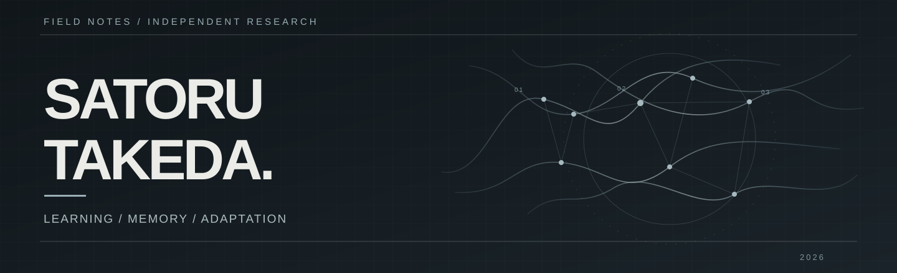

**Building small systems that learn from experience.**

CONTINUAL LEARNING &nbsp; / &nbsp; CPU-FIRST SYSTEMS &nbsp; / &nbsp; ADAPTIVE AGENTS

---

## Current focus

### [01 / Tiny Learner](https://github.com/mira-takeda/tiny-learner)

**Learn. Remember. Adapt.**

A compact learning system investigating how skills can be acquired through experience, preserved through continued learning, and reused when conditions change.

META GLOBAL AI DEVELOPER HACKATHON 2026

[Explore Tiny Learner](https://github.com/mira-takeda/tiny-learner)

---

## Independent experiments

### 02 / SEMILLA

**Learning from consequences**

Research into systems that interpret the effects of their actions, detect environmental change, and adjust behavior from experience.

### 03 / IRIA & XILA

**Two agents. A shared environment.**

A paired-agent investigation of learning through interaction and observation, with alternating actor and observer roles.

---

## A common direction

> **What can a compact system learn, remember, and reuse without starting over?**

Different projects explore different approaches to this question. The work centers on continual learning, adaptation, and controlled experimentation.

LEARNING &nbsp; · &nbsp; MEMORY &nbsp; · &nbsp; ADAPTATION

